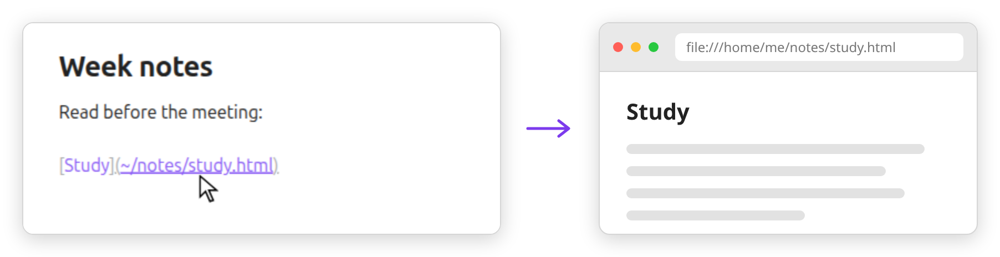

# Local Links

**Link to any file on your computer. Click it, and it opens.**

<picture><source media="(prefers-color-scheme: dark)" srcset="docs/demo-dark.png"></picture>

Out of the box, Obsidian reads `[Study](~/notes/study.html)` as a note in your vault. Clicking it creates an empty `study.html` note, inside a new `~` folder.

With Local Links, the file opens:

- HTML in the browser you choose, `#anchors` included
- PDFs, folders and everything else in their default app
- `~/path`, `/absolute/path` and `file:///` links
- a missing file shows a notice, and no note is created

Desktop only. Tested on Linux.

## Install

Copy `main.js` and `manifest.json` into `<vault>/.obsidian/plugins/local-links/`, then turn on **Local Links** in Settings → Community plugins.

## Settings

- **Browser command**: `brave-browser` by default. Arguments are fine (`brave-browser --incognito`). Leave it empty to use the system default.
- **Browser extensions**: `html, htm` by default.

A path with spaces needs angle brackets, as in any Markdown link: `[a](<~/my notes/a.html>)`.

## More

- [Limits](docs/limits.md): what the tests do not cover, and edge cases
- [Alternatives](docs/alternatives.md): the plugins that come close, and why this one exists
- Tests: `node test/test.js`, and `dev/e2e.sh`, which clicks real links in a throwaway Obsidian
